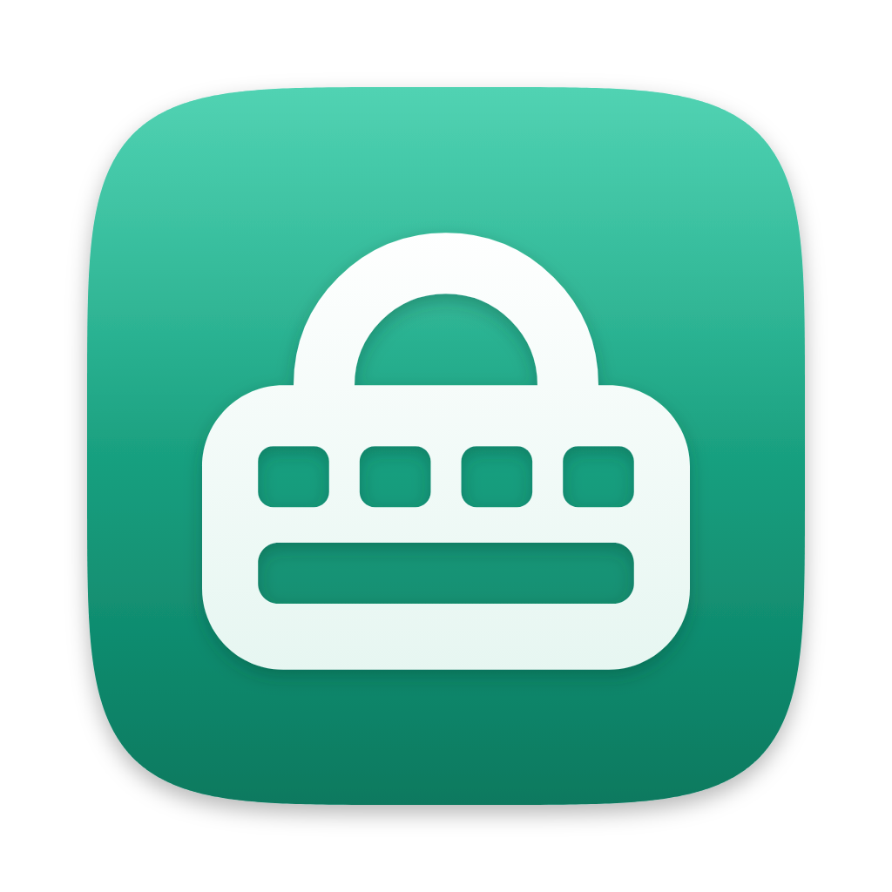

# InputLock



macOS 菜单栏小工具，解决「mac 上打字时输入法自己跳来跳去」的问题：

- **锁定输入法**：无论你切到哪个 App、哪个窗口，始终保持你指定的输入法，不再被系统或其它软件偷偷改成 ABC；
- **密码框自动切英文**：光标进入密码框 / 安全输入框时自动切到英文键盘布局，离开后立刻切回你锁定的输入法；
- **零界面**：只有菜单栏图标，没有 Dock 图标、没有窗口。

## 功能

| 功能 | 说明 |
| --- | --- |
| 输入法锁定 | 指定一个输入法作为「目标输入法」，InputLock 会持续把它保持在前台 |
| 锁定当前输入法 | 菜单里一键把「此刻正在用的输入法」设为目标，不用去列表里找 |
| 密码框切英文 | 检测到安全输入框（`NSSecureTextField` / 密码输入区域）时临时切到英文布局，离开后切回 |
| 英文键盘选择 | 默认自动（ABC → US → 任意英文布局），也可手动指定某个英文布局 |
| 开机启动 | 基于 `SMAppService`，在「系统设置 › 通用 › 登录项」里可见、可关闭 |
| 菜单栏状态 | 图标随状态变化：锁定 / 密码框 / 停用三态各有专用 template 图标（见[图标](#图标)）；图标旁显示目标输入法短名 |
| 辅助功能权限 | 菜单里显示授权状态，未授权时可直接请求 / 跳到系统设置 |

菜单结构：

```
InputLock 状态摘要
目标输入法：xxx
────────────────
☑ 启用输入法锁定
  锁定输入法 ▸ 锁定当前输入法（xxx）
               ────────────
               ABC
               拼音 - 简体
               …（全部可选输入法，按名称排序）
☑ 密码框自动切英文
  英文键盘 ▸ 自动（ABC / US / 任意英文布局）
             ────────────
             ABC
             US
立即重新应用锁定
────────────────
☐ 开机启动：未开启
辅助功能权限：未授权，点此请求授权…
打开系统设置 › 隐私与安全性 › 辅助功能
────────────────
退出 InputLock
```

## 下载安装

不想自己编译就直接去 [Releases](https://github.com/DueGin/inputAppLock/releases) 下载现成的：

1. 下载最新版的 `InputLock-<版本>-macos-universal.zip`——通用二进制，Apple Silicon 与 Intel 都能跑，要求 macOS 13+；
2. 解压，把 `InputLock.app` 拖进 `/Applications`；
3. **首次打开会被 Gatekeeper 拦下**，这是预期行为：发版产物是 ad-hoc 签名、没做 Apple 公证。任选一种放行：
   - 终端执行 `xattr -dr com.apple.quarantine /Applications/InputLock.app`，然后正常双击打开；
   - 或者右键（Control-点击）`InputLock.app` →「打开」→ 弹窗里再点一次「打开」；
   - 还不行就去「系统设置 › 隐私与安全性」，页面底部点「仍要打开」；
4. 启动后在「系统设置 › 隐私与安全性 › 辅助功能」里勾选 **InputLock**（详见[授予辅助功能权限](#授予辅助功能权限)）；
5. 菜单栏出现锁形图标，点菜单「锁定输入法 › 锁定当前输入法」即可。

想校验下载完整性的话，把 `.zip` 和同名 `.zip.sha256` 放同一个目录，然后：

```bash
shasum -a 256 -c InputLock-<版本>-macos-universal.zip.sha256
```

> 每次更新都是覆盖 `/Applications/InputLock.app`；ad-hoc 签名每次都会变，所以覆盖后可能要在辅助功能里把 InputLock 取消勾选再加回来一次。

## 支持的输入法

**支持所有输入法**——系统自带的和任意第三方 IME 都可以，列表完全来自系统的 TIS（Text Input Sources）API，程序里没有写死任何输入法名字：

- 系统自带：ABC、US、拼音 - 简体、拼音 - 繁体、双拼、五笔、仓颉、手写、Emoji 等；
- 第三方 IME：搜狗输入法、豆包输入法、微信输入法、百度输入法、QQ 输入法、Rime / 鼠须管、iBus、清歌、落格……只要它在系统「键盘 › 输入法」列表里出现过，就会出现在 InputLock 的「锁定输入法」子菜单里。

> 豆包、搜狗在这里只是**举例**，不是特殊适配对象。InputLock 不针对任何具体 IME 写逻辑，所以新装的输入法不需要更新本程序。

**关于第三方 IME 的中/英状态保持**：像搜狗、豆包这类输入法，自己的「中文 / 英文」是 IME 内部状态（不是系统输入源）。InputLock 只切换**系统输入源**，不会去动 IME 内部状态，所以：

1. 你在搜狗里处于中文状态 → 进入密码框 → InputLock 切到 ABC → 你输入密码 → 离开密码框 → InputLock 切回搜狗 → **仍然是中文状态**，不用重新按 Shift；
2. 反过来，如果你在搜狗里手动切到英文状态再离开某个 App，InputLock 也不会强行把它改回中文——它只保证「输入源是搜狗」，IME 内部状态由你自己决定；
3. 少数 IME 会在被重新激活时重置自己的中英状态（各家实现不同），这种情况下 InputLock 无能为力，因为它只操作系统层输入源；此时把「密码框自动切英文」关掉即可完全避免切换。

## 图标

App 图标与菜单栏图标由设计交付，源文件都在 [`assets/logo/`](assets/logo/)，设计说明见 [`assets/logo/README.md`](assets/logo/README.md)。

| 用途 | 文件 | 打包后的位置 |
| --- | --- | --- |
| App 图标（Finder / Dock / 登录项） | `Resources/AppIcon.icns` | `Contents/Resources/AppIcon.icns`，`Info.plist` 里 `CFBundleIconFile` = `CFBundleIconName` = `AppIcon` |
| 菜单栏 · 已锁定 | `assets/logo/menubar/MenuBarIconTemplate.png` / `@2x.png` | `Contents/Resources/` |
| 菜单栏 · 密码框英文模式 | `assets/logo/menubar/MenuBarIconSecureTemplate.png` / `@2x.png` | `Contents/Resources/` |
| 菜单栏 · 未启用 | `assets/logo/menubar/MenuBarIconDisabledTemplate.png` / `@2x.png` | `Contents/Resources/` |

- 菜单栏图标是纯黑 + alpha 的 **template image**（代码里 `isTemplate = true`），深浅色菜单栏由系统自动着色，按 18×18 pt 显示，`@2x` 由 `Bundle.image(forResource:)` 自动合并；
- 打包脚本只复制 PNG，`assets/logo/menubar/*.svg` 是矢量源文件，不进 bundle；
- 直接运行 `.build` 下的裸二进制（没有 bundle 资源）时，菜单栏会自动退回 SF Symbol（锁定 `lock.fill`、密码框 `keyboard`、停用 `lock.open`），不影响功能。

## 构建

要求：macOS 13+、Xcode 或 Command Line Tools（Swift 5.9+）。

```bash
cd inputAppLock
swift build -c release          # 只编译
./scripts/build_app.sh          # 编译 + 组装 build/InputLock.app + ad-hoc 签名

# 可选环境变量，本地默认行为不变
UNIVERSAL=1 ./scripts/build_app.sh                                  # arm64 + x86_64 通用二进制
VERSION=1.2.3 ./scripts/build_app.sh                                # 把版本号写进 .app 内的 Info.plist
UNIVERSAL=1 VERSION=1.2.3 BUILD_NUMBER=42 ./scripts/build_app.sh    # CI 发版用的组合
```

`scripts/build_app.sh` 会做这些事：

1. `swift build -c release`——`UNIVERSAL=1` 时改用 `swift build -c release --arch arm64 --arch x86_64`（`--show-bin-path` 也带同样的 `--arch`）。机器上只有 Command Line Tools、没有完整 Xcode 时，SwiftPM 的 `--arch` 会缺 xcbuild 而报错，脚本会自动回退成「arm64 + x86_64 分架构编译再 `lipo -create`」，本地一样能出通用包；
2. 把可执行文件复制进 `build/InputLock.app/Contents/MacOS/InputLock`；
3. 复制 `Resources/Info.plist`（`LSUIElement=true`，bundle id `com.duegin.InputLock`）；给了 `VERSION` 时用 `PlistBuddy` 把 `CFBundleShortVersionString` 改成它（前缀 `v` 自动去掉），`CFBundleVersion` 取 `BUILD_NUMBER` → `GITHUB_RUN_NUMBER` → `VERSION`。**只改打好的 `.app` 里的副本，源 `Resources/Info.plist` 不动**；
4. 复制图标资源：`AppIcon.icns` 与三套菜单栏 template PNG（含 `@2x`）到 `Contents/Resources/`，然后 `touch` 一次 `.app` 让 Finder 重新读图标缓存；
5. `codesign --force --deep -s - build/InputLock.app` 做 ad-hoc 签名，最后打印版本号与 `lipo -archs` 架构。

完成后输出 `.app` 路径，直接 `open build/InputLock.app` 即可。

> ad-hoc 签名只适合本机自用。要分发给别人（或避免每次重编译后重新授权），需要开发者证书正式签名：
> `codesign --force --deep --sign "Developer ID Application: ..." build/InputLock.app`

## 从源码安装

自己编译安装走这里；只想装现成的看上面的[下载安装](#下载安装)。

```bash
./scripts/build_app.sh
cp -R build/InputLock.app /Applications/
open /Applications/InputLock.app
```

启动后菜单栏出现锁形图标，没有 Dock 图标（`LSUIElement`）。想开机自动运行：菜单里勾选「开机启动」。

卸载：退出程序，删掉 `/Applications/InputLock.app`，再在「系统设置 › 通用 › 登录项」里移除残留条目即可。

## 发版流程

发版由 tag 驱动，流水线在 [`.github/workflows/release.yml`](.github/workflows/release.yml)：

```bash
git tag v1.0.0
git push origin v1.0.0
```

push 匹配 `v*` 的 tag 后，GitHub Actions（`macos-15`，arm64 runner）自动：

1. 从 tag 名去掉前缀 `v` 得到版本号（`v1.0.0` → `1.0.0`），`CFBundleVersion` 用 `GITHUB_RUN_NUMBER`；
2. `UNIVERSAL=1 VERSION=<版本> ./scripts/build_app.sh` 构建 arm64 + x86_64 通用 `.app`（ad-hoc 签名）；
3. `ditto -c -k --keepParent --norsrc --noextattr` 打成 `InputLock-<版本>-macos-universal.zip` 并生成 `.sha256`（`--norsrc --noextattr` 是为了不把 `._*` AppleDouble 文件塞进包里，否则 `unzip` 解压后签名校验会失败）；
4. 用 `softprops/action-gh-release` 创建 Release：自动生成 release notes，上传 zip 与 sha256，正文附带安装说明（解压拖入 `/Applications`、`xattr` 放行 Gatekeeper、辅助功能授权）。

其他说明：

- **手动测试**：Actions → Release → Run workflow（`workflow_dispatch`）。手动触发只构建并上传 artifact，**不创建 Release**，方便先验证流水线；
- **本地模拟一次发版**：`UNIVERSAL=1 VERSION=1.2.3 ./scripts/build_app.sh`，产物在 `build/InputLock.app`，再用 `lipo -archs` 和 `PlistBuddy` 检查；
- **签名**：发版保持 ad-hoc 签名，不引入证书 secrets，所以产物未公证，用户首次打开需要放行 Gatekeeper。将来要接 Developer ID 签名 + 公证（`notarytool` / `stapler`），步骤写在 workflow 的注释里，当前不实现；
- **tag 别复用**：发新版请递增 tag（`v1.0.1`、`v1.1.0`…）；重跑同一次 workflow 会更新同名 Release 的资产。

## 授予辅助功能权限

InputLock 需要「辅助功能（Accessibility）」权限才能检测当前焦点是不是密码框：

1. 首次启动菜单里会显示「辅助功能权限：未授权，点此请求授权…」；
2. 点它，系统会弹出授权提示（或在菜单里点「打开系统设置 › 隐私与安全性 › 辅助功能」）；
3. 在「系统设置 › 隐私与安全性 › 辅助功能」里勾选 **InputLock**；
4. 回到菜单，状态变成「辅助功能权限：已授权」。

注意：

- 每次重新编译并覆盖 `.app` 后，签名变化会导致系统重新询问权限，勾掉旧的 InputLock 再重新添加即可；
- 没授权时「锁定输入法」可能仍部分可用，但密码框检测一定不生效；
- 权限没生效时先退出程序再重新打开。

## 使用建议

1. 先把系统「键盘 › 输入法」里不需要的输入法删掉，只留下常用的（列表越短越好选）；
2. 启动 InputLock，点菜单「锁定输入法 › 锁定当前输入法」；
3. 保持「启用输入法锁定」和「密码框自动切英文」勾选；
4. 如果某个 App 你确实需要自由切换输入法，临时把「启用输入法锁定」取消勾选即可。

## 项目结构

```
Package.swift                       SwiftPM 清单（macOS 13+，单 executableTarget）
Sources/InputLock/App/
  main.swift                        入口
  AppDelegate.swift                 应用生命周期、装配 settings/controller/菜单
  StatusMenuController.swift        菜单栏图标与菜单
  AppSettings.swift                 UserDefaults 设置（实现 LockSettingsProviding）
  LaunchAtLogin.swift               SMAppService 开机启动
Sources/InputLock/Core/             输入法切换 / 焦点检测 / 锁定逻辑（Core 模块）
Resources/Info.plist                bundle 配置
Resources/AppIcon.icns              App 图标（由 assets/logo/app-icon/AppIcon.iconset 生成）
assets/logo/                        Logo 源文件与菜单栏图标（设计交付，含 README 设计说明）
scripts/build_app.sh                打包脚本（UNIVERSAL / VERSION 环境变量、图标资源复制、ad-hoc 签名）
.github/workflows/release.yml       打 tag 自动构建通用包并发布 Release
docs/CONTRACT.md                    Core 与 App 的接口契约
```

## 常见问题

- **锁不住**：先确认辅助功能已授权，再点菜单「立即重新应用锁定」；某些 App（如部分游戏、全屏程序）会绕过系统输入源，无法锁定。
- **密码框不切英文**：确认「密码框自动切英文」已勾选；个别 App 用自绘输入框，系统识别不到安全输入。
- **菜单里没看到某个输入法**：先在「系统设置 › 键盘 › 输入法」里添加它，再重新打开菜单（列表在每次打开菜单时刷新）。
- **重启后不自动运行**：检查「系统设置 › 通用 › 登录项」，macOS 13 起新注册的登录项需要你手动允许。
- **打开提示「已损坏」/「无法验证开发者」**：Release 包是 ad-hoc 签名、未公证，属于预期行为。执行 `xattr -dr com.apple.quarantine /Applications/InputLock.app`，或右键 App →「打开」，或去「系统设置 › 隐私与安全性」点「仍要打开」。
- **覆盖安装后辅助功能失效**：ad-hoc 签名每次构建都不同，去「辅助功能」里取消勾选 InputLock 再加回来即可。
